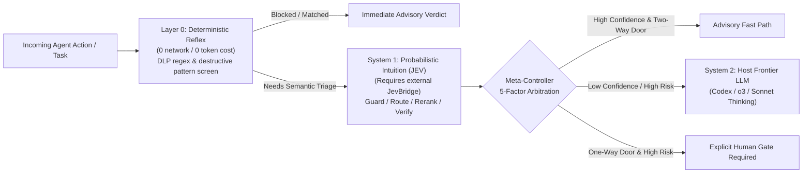

# jev-cognitive-mcp

**English** · [简体中文](README.zh-CN.md)

[](https://github.com/17671454333/jev-cognitive-mcp/actions/workflows/ci.yml)
[](LICENSE)
[](pyproject.toml)
[](jev_kit/mcp_server.py)

**Advisory 3+1 Cognitive Hierarchy Toolkit & Model Context Protocol (MCP) Server for Coding Agents (OpenAI Codex CLI, Claude Code, Cursor, Antigravity).**

`jev-cognitive-mcp` provides deterministic Layer-0 DLP/destructive command pre-screening, 5-factor Meta-Controller escalation arbitration, and optional System-1 probabilistic triage (`guard`, `route`, `verify`, `rerank`) over stdio MCP. All verdicts and routing signals are **advisory**—the host agent remains responsible for enforcing command blocking, sandboxing, and human-in-the-loop approval gates.

---

## Architecture: The 3+1 Cognitive Hierarchy



| Layer | Role | Execution Mode | Responsibility |
|---|---|---|---|
| **Layer 0 (Reflex)** | Deterministic Code | Local offline (`0 tokens`, no network call) | Pre-egress regex DLP credential screening (`sk-*`, `ghp_*`, `glpat-*`, `AKIA*`, `Bearer`, `password=`, `secret=`, `api_key=`, `token=`, PEM keys), destructive shell pattern matching (`rm -rf /`, `rm -rf -- /`, `Remove-Item -Recurse -Force`, `mkfs`, `DROP DATABASE`, `curl \| bash`), strict schema validation |
| **System 1 (Intuition)** | Probabilistic JEV | External `JevBridge` single-attempt call | Multi-head `noul` (boolean probability), `choice` (categorical distribution), and `score` (0..4 ordinal rubric) evaluations |
| **System 2 (Reasoning)** | Host Frontier LLM | Host agent runtime | Complex causal reasoning, multi-file architecture design, subtle debugging |
| **Meta-Controller** | Control Plane | Local offline (`0 tokens`, no network call) | Arbitrates escalation using 5 quantitative signals: **Confidence**, **Risk**, **Reversibility**, **Expected Value**, and **Cost Pressure** |

---

## Core Modules & MCP Tools

1. **`jev_guard` (`jev_kit.guard`) — Advisory Pre-Tool Command Risk Screen**
   - Evaluates shell commands before execution and returns an advisory action (`ALLOW`, `INSPECT`, `ESCALATE_HUMAN`, or `BLOCK`).
   - **Layer 0 (`reflex_only=true` or pre-screen)**: Blocks literal credential egress (`SENSITIVE_INPUT_REJECTED`) and known destructive shell/PowerShell patterns locally with zero network calls.
   - **System 1 (when `reflex_only=false`)**: Evaluates `is_destructive`, `is_rce_or_exfil`, and `is_secret_leak` probabilities via `JevBridge`.
2. **`jev_arbitrate` (`jev_kit.controller`) — Offline 5-Factor Meta-Controller**
   - Purely deterministic calculation of expected escalation utility from `(confidence, risk, reversible, expected_value, cost_pressure)`. Recommends `human_gate` on irreversible high-risk actions. Works completely offline.
3. **`jev_route` (`jev_kit.router`) — Advisory Task & Model Tier Router**
   - Classifies incoming coding prompts into `FAST` (`codex-mini-latest`, `gpt-4o-mini`), `STANDARD` (`gpt-4.1`, `gpt-4o`), or `DEEP_REASONING` (`o3`, `codex-1`) tiers while estimating architectural scope.
4. **`jev_verify` (`jev_kit.verifier`) — Caller-Supplied Completion & Acceptance Review**
   - Reviews caller-supplied `task_spec`, `implemented_changes` summary, and `test_results` logs to return `PASS`, `ADVISORY`, or `NEEDS_REVISION`. Does **not** inspect git repositories or run test suites directly.
5. **`jev_rerank` (`jev_kit.reranker`) — Bounded Semantic Candidate Reranker**
   - Ranks up to 96 caller-supplied code snippets or issue candidates in deterministic batches of 12 while preserving full provenance and failing closed on partial batch errors.

---

## Offline Deterministic Mode vs. External `JevBridge` Requirement

- **Works 100% Offline (Zero External Dependencies)**:
  - `jev_arbitrate` (5-factor Meta-Controller)
  - `jev_guard` with `reflex_only=true` (`jev-kit guard "<cmd>" --reflex-only`)
  - `jev-kit init-codex` (configuration generator for OpenAI Codex CLI and MCP clients)
  - Pre-egress credential DLP screening inside `call_jev()` (blocks sensitive tokens before any bridge lookup)
- **Requires External `JevBridge` Runtime**:
  - `jev_guard` (when `reflex_only=false` and Layer 0 does not match), `jev_route`, `jev_verify`, and `jev_rerank` invoke `jev_cli.py` from the local `JevBridge` runtime directory.
  - Set `JEV_BRIDGE_DIR=/path/to/JevBridge/runtime` (defaults to `%LOCALAPPDATA%\JevBridge\runtime` on Windows or `~/.local/share/JevBridge/runtime` on Linux/macOS). If the bridge runtime is not installed, these tools fail closed with `JevIntegrationError(code="BRIDGE_MISSING")`.

---

## Quick Start

### 1. Installation

```bash
git clone https://github.com/17671454333/jev-cognitive-mcp.git
cd jev-cognitive-mcp
pip install -e ".[dev]"
```

### 2. Wire into OpenAI Codex CLI (`~/.codex/config.toml`)

Generate the exact TOML snippet with `jev-kit init-codex --format toml` and add it to `~/.codex/config.toml`:

```toml
[mcp_servers.jev_cognitive]
command = "jev-mcp"
args = []
```

### 3. Wire into JSON MCP Clients (Claude Code, Cursor, Antigravity)

Generate with `jev-kit init-codex --format json`:

```json
{
  "mcpServers": {
    "jev-cognitive": {
      "command": "jev-mcp",
      "args": []
    }
  }
}
```

### 4. CLI Usage & Verification

```bash
# Generate OpenAI Codex CLI config.toml snippet
jev-kit init-codex --format toml

# Layer-0 deterministic reflex screen (offline, 0 tokens)
jev-kit guard "rm -rf -- /" --reflex-only

# 5-factor Meta-Controller arbitration (offline, 0 tokens)
jev-kit arbitrate --confidence 0.62 --risk 0.75 --irreversible --value 0.85

# Run deterministic unit test suite
python -m unittest discover -s tests -v
```

---

## Security & Reliability Boundaries

- **Pre-Egress Credential DLP Chokepoint**: Both `local_reflex_screen()` and `call_jev()` screen serialized inputs for literal secrets (`sk-*`, `ghp_*`, `glpat-*`, `AKIA*`, `Bearer`, `password=`, `secret=`, `api_key=`, `token=`, PEM private keys, and URL userinfo credentials) and raise `SENSITIVE_INPUT_REJECTED` before `_invoke_bridge()` can be called.
- **Zero Direct Credential Arguments**: `call_jev()` rejects explicit `api_key`, `token`, or `secret` keyword arguments (`DIRECT_CREDENTIALS_DISABLED`).
- **Advisory Boundary**: Outputs from `jev-cognitive-mcp` are advisory structured signals; host agents must enforce execution blocking and human approval gates.
- **No Silent Fallbacks**: Timeouts, missing bridge runtimes (`BRIDGE_MISSING`), or malformed responses raise `JevIntegrationError` with explicit `billing_uncertain` tracking rather than defaulting to `ALLOW` or `PASS`.

## License

Released under the [MIT License](LICENSE).
