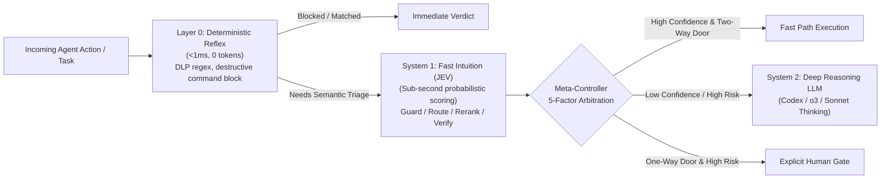

# jev-cognitive-mcp

**English** · [简体中文](README.zh-CN.md)

[](https://github.com/17671454333/jev-cognitive-mcp/actions/workflows/ci.yml)
[](LICENSE)
[](pyproject.toml)
[](jev_kit/mcp_server.py)

**3+1 Cognitive Hierarchy Toolkit & Model Context Protocol (MCP) Server for Autonomous Coding Agents (OpenAI Codex CLI, Claude Code, Cursor, Antigravity).**

`jev-cognitive-mcp` prevents coding agents from burning reasoning tokens on trivial pattern checks, executing destructive or secret-leaking shell commands, or prematurely declaring incomplete diffs "done."

---

## Architecture: The 3+1 Cognitive Hierarchy



| Layer | Role | Latency / Cost | Responsibility |
|---|---|---|---|
| **Layer 0 (Reflex)** | Deterministic Code | `< 1 ms` / `0 tokens` | Regex DLP secret screening (`sk-*`, `ghp_*`, `Bearer`), destructive shell blocking (`rm -rf /`, `mkfs`, `DROP DATABASE`, `curl \| bash`), strict JSON schema bounds |
| **System 1 (Intuition)** | Probabilistic JEV | `~80–250 ms` / Micro-cost | Multi-head `noul` (boolean probability), `choice` (categorical distribution), and `score` (0..4 ordinal rubric) evaluations |
| **System 2 (Reasoning)** | Host Frontier LLM | Seconds / Full budget | Complex causal reasoning, multi-file architecture design, subtle concurrency debugging |
| **Meta-Controller** | Control Plane | `< 1 ms` / `0 tokens` | Arbitrates escalation using 5 quantitative signals: **Confidence**, **Risk**, **Reversibility**, **Expected Value**, and **Cost Pressure** |

---

## Core Modules & MCP Tools

1. **`jev_guard` (`jev_kit.guard`) — Pre-Tool Execution Security Gate**
   - Screens shell commands before execution.
   - Layer 0 blocks literal credential egress (`SENSITIVE_INPUT_REJECTED`) and destructive shell pipes immediately with zero network calls.
   - System 1 evaluates `is_destructive`, `is_rce_or_exfil`, and `is_secret_leak` probabilities.
2. **`jev_route` (`jev_kit.router`) — Dynamic Task & Model Tier Router**
   - Classifies incoming coding prompts into `FAST` (`codex-mini-latest`, `gpt-4o-mini`), `STANDARD` (`gpt-4.1`, `gpt-4o`), or `DEEP_REASONING` (`o3`, `codex-1`) tiers while estimating architectural blast radius.
3. **`jev_verify` (`jev_kit.verifier`) — Unbiased Completion & Acceptance Gate**
   - Evaluates the original specification, implemented diff summary, and test runner output to return `PASS`, `ADVISORY`, or `NEEDS_REVISION`.
4. **`jev_rerank` (`jev_kit.reranker`) — Bounded Semantic Candidate Reranker**
   - Ranks up to 96 code snippets or issue candidates in deterministic batches of 12 while preserving full provenance and failing closed on partial batch errors.
5. **`jev_arbitrate` (`jev_kit.controller`) — 5-Factor Meta-Controller**
   - Computes expected escalation utility from `(confidence, risk, reversible, expected_value, cost_pressure)` and enforces hard human gates on irreversible high-risk actions.

---

## Quick Start

### 1. Installation

```bash
git clone https://github.com/17671454333/jev-cognitive-mcp.git
cd jev-cognitive-mcp
pip install -e ".[dev]"
```

### 2. Wire into OpenAI Codex CLI / MCP Clients

Add `jev-cognitive-mcp` to your MCP configuration (`~/.codex/config.toml` or `mcp_config.json`):

```json
{
  "mcpServers": {
    "jev-cognitive": {
      "command": "jev-mcp",
      "args": []
    }
  }
}
```

### 3. CLI Usage

```bash
# Layer-0 deterministic reflex screen (0 tokens)
jev-kit guard "rm -rf / --no-preserve-root" --reflex-only

# 5-factor Meta-Controller arbitration
jev-kit arbitrate --confidence 0.62 --risk 0.75 --irreversible --value 0.85

# Run full test suite
pytest -v
```

---

## Security & Reliability Guarantees

- **Zero Direct Credential Handling**: `call_jev()` rejects explicit `api_key` parameters (`DIRECT_CREDENTIALS_DISABLED`). Credentials remain isolated in the local bridge runtime.
- **No Silent Fallbacks**: Timeouts, malformed responses, or missing confidence buckets never default to `ALLOW` or `PASS`; they raise `JevIntegrationError` with explicit `billing_uncertain` tracking.
- **Single-Attempt Budget Discipline**: Each logical call performs at most one upstream evaluation with zero automatic retries.

## License

Released under the [MIT License](LICENSE).
